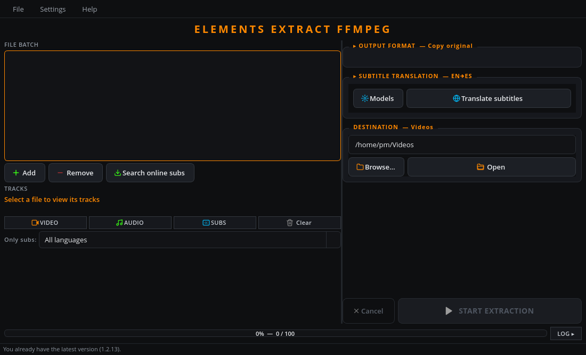
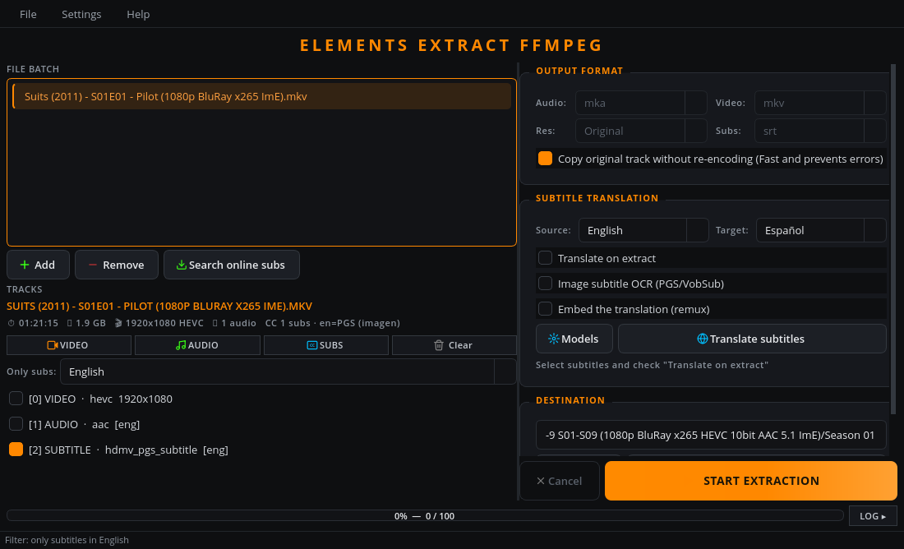
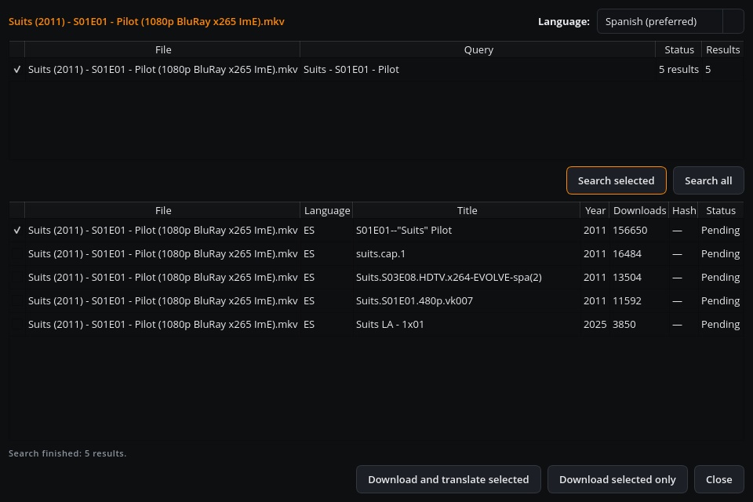
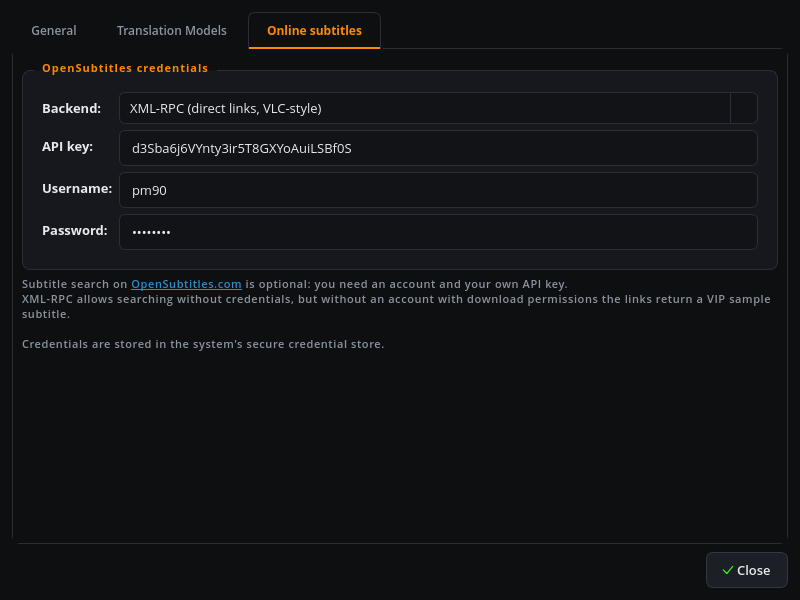

# Elements Extract — FFmpeg

> Descargaste una película o una serie… y le falta lo único que tiene que tener: **el subtítulo en tu idioma**.

**Elements Extract** es un extractor gráfico de pistas de audio, vídeo y subtítulos con procesamiento en lote, que además **traduce subtítulos a tu idioma de forma 100 % offline**, directamente en tu equipo.


---

## 🎯 Por qué existe este proyecto

Este proyecto nació de una necesidad personal. Cuando descargo una película o una serie, a veces pasa esto:

- El subtítulo que necesito **no está disponible** o no existe en mi idioma.
- El único que encuentro está **mal sincronizado** o es de baja calidad.
- No quiero depender de ninguna web para buscarlo ni para "conseguirlo".

Entonces pensé: *¿y si pudiera tomar el archivo que ya tengo en el disco y traducir su subtítulo yo mismo, en mi casa, sin internet?*

**Elements Extract** es exactamente eso: una herramienta **offline** que extrae las pistas de tu archivo y **traduce los subtítulos al idioma que quieras con tu propio equipo**, sin depender de internet para encontrarlos.

> 🔒 **Privacidad:** tus archivos nunca salen de tu máquina. La búsqueda online es opcional y solo envía el hash y los metadatos del archivo, nunca el vídeo. La traducción se realiza localmente con modelos de traducción neuronal (vía [bergamot-translator](https://github.com/browsermt/bergamot-translator)). Solo necesitas internet **una vez**, para descargar el modelo de idioma; después puedes traducir todo lo que quieras, estés donde estés.

---

## Capturas

| Ventana principal | Filtro Solo subs |
|---|---|
|  |  |
| Búsqueda de subtítulos online | Ajustes: backend XML-RPC |
|  |  |

---

## Características

- 📂 **Procesamiento en lote** — añade múltiples archivos a la vez
- 🎯 **Selección individual de pistas** — marca exactamente qué pistas extraer de cada archivo
- ▶ **Selección global por tipo** — botones VIDEO / AUDIO / SUBS para seleccionar todas las pistas de un tipo en todo el lote
- 📊 **Panel de metadatos** — muestra duración, tamaño, resolución, número de pistas al seleccionar un archivo
- 🔄 **Formatos de salida configurables** — elige entre MKA, M4A, AAC, MP3, FLAC, OPUS, WAV para audio; MKV, MP4, AVI para video; SRT, ASS, VTT para subtítulos
- 📈 **Barra de progreso real** — calcula el porcentaje en base a la duración del archivo
- ✋ **Cancelación** — cancela el proceso en cualquier momento
- 💾 **Persistencia** — guarda la carpeta de destino, formatos y tamaño de ventana entre sesiones
- 🖱️ **Drag & Drop** — arrastra archivos directamente a la ventana
- ⌨️ **Atajos de teclado** — `Ctrl+O`, `Del`, `Ctrl+Enter`, `Escape`, `F1`
- 🌐 **Traducción de subtítulos offline** — traduce subtítulos extraídos al idioma que quieras (en, es, fr, pt)
- 🌐 **Subtítulos online** — búsqueda manual y por lote en opensubtitles.org (XML-RPC estilo VLC, sin clave API) o en opensubtitles.com (REST), con descarga y traducción posterior
- 🅾️ **OCR de imagen (experimental)** — convierte PGS/VobSub a `.srt` con nOCR; desactivado por defecto y con progreso en el registro
- 🔔 **Aviso de versiones nuevas** — consulta GitHub Releases al arrancar; también en Ayuda → Buscar actualizaciones…
- ➡️ **Incrustar la traducción (remux)** — el subtítulo traducido se incrusta en un nuevo .mkv/.mp4 con el vídeo y el audio originales, sin re-codificar (estilo MKVToolNix)
- 🎯 **Filtro de subtítulos por idioma** — selecciona y traduce solo los subtítulos de un idioma concreto en todos los archivos del lote
- 🔄 **Traducción triangular** — si no hay modelo directo (ej. pt→es), usa intermediarios (pt→en→es)
- 🤖 **Detección automática de idioma** — detecta el idioma de los subtítulos desde la metadata del archivo
- ⬇️ **Modelos descargables** — descarga modelos de traducción desde translatelocally.com (solo una vez)

---

## Formatos soportados

### Contenedores de entrada

| Formato | Pistas de video | Pistas de audio | Subtítulos | Notas |
|---------|----------------|-----------------|------------|-------|
| **MKV** (Matroska) | Múltiples | Múltiples | SRT, ASS, PGS, DVB | El más completo — soporta casi todo |
| **MP4** | 1-2 | Múltiples | mov_text, cea-608 | Estándar web — compatibilidad universal |
| **AVI** | 1 | 1-2 | Sin subtítulos | Formato legacy |
| **TS/M2TS** | Múltiples | Múltiples | DVB, PGS | Blu-ray y broadcast |
| **OGG/OGM** | Múltiples | Múltiples | SRT | Open source |
| **FLV** | 1 | 1-2 | Sin subtítulos | Flash (obsoleto) |
| **WMV** | 1 | 1-2 | SRT | Windows Media |

### Códecs soportados (vía ffmpeg)

- **Video**: H.264, H.265/HEVC, VP8, VP9, AV1, MPEG-2, MPEG-4, Theora
- **Audio**: AAC, MP3, FLAC, Opus, Vorbis, AC3, DTS, PCM, ALAC
- **Subtítulos**: SRT, ASS/SSA, PGS (Blu-ray), DVB, WebVTT, mov_text

### Formatos de salida

| Tipo | Formatos |
|------|----------|
| **Audio** | MKA, M4A, AAC, MP3, FLAC, OPUS, WAV |
| **Video** | MKV, MP4, AVI |
| **Subtítulos** | SRT, ASS, VTT (texto); MKS (imagen, copia de flujo) |

> ℹ️ **Subtítulos de imagen** (PGS de Blu-ray, VobSub/DVD, DVB, XSUB) se extraen tal cual como `.mks` mediante copia de flujo, sin recodificar. Opcionalmente, la casilla **«OCR de subtítulos de imagen»** (experimental, desactivada por defecto) usa **nOCR** para generar un `.srt` traducible. Puede tardar varios minutos por episodio y conviene revisar el resultado; la copia `.mks` se conserva si el OCR falla.

### Traducción de subtítulos

| Par | Disponibilidad |
|-----|---------------|
| English → Español | ✅ Modelo directo |
| Español → English | ✅ Modelo directo |
| English → Français | ✅ Modelo directo |
| Français → English | ✅ Modelo directo |
| English → Português | ✅ Modelo directo |
| Português → English | ✅ Modelo directo |
| Português → Español | ↻ Via triangular (pt→en→es) |
| Español → Português | ↻ Via triangular (es→en→pt) |
| Francés → Español | ↻ Via triangular (fr→en→es) |

---

## Dependencias

| Dependencia | Versión mínima | Uso |
|-------------|----------------|-----|
| Qt6 Widgets | 6.2 | Interfaz gráfica |
| FFmpeg      | 4.0  | Motor de extracción de pistas |
| ffprobe     | 4.0  | Análisis de streams y metadatos |
| CMake       | 3.5  | Sistema de compilación |
| C++ compiler| C++17 | GCC ≥ 7 / Clang ≥ 5 |
| zlib1g-dev   | —     | Descompresión de la base nOCR del OCR opcional |

> **Nota sobre versiones de ffmpeg**: Versión 4.x+ recomendada para mejor soporte de subtítulos PGS (Blu-ray) y códecs modernos (AV1, Opus). Cualquier ffmpeg de los últimos 3 años funciona correctamente.

### Instalar dependencias en Debian/Ubuntu

```bash
sudo apt install qt6-base-dev libgl1-mesa-dev cmake build-essential ffmpeg zlib1g-dev
```

### Instalar dependencias en Fedora

```bash
sudo dnf install qt6-qtbase-devel cmake gcc-c++ ffmpeg
```

### Instalar dependencias en Arch Linux

```bash
sudo pacman -S qt6-base cmake base-devel ffmpeg
```

---

## Compilar e instalar

```bash
# Clonar el repositorio
git clone https://github.com/pdmiguel90-droid/elements-extract.git
cd elements-extract

# Crear directorio de build
mkdir build && cd build

# Configurar y compilar
cmake .. -DCMAKE_BUILD_TYPE=Release
make -j$(nproc)

# Ejecutar directamente
./elements-extract
```

### Instalación en el sistema (opcional)

```bash
# Copiar el binario
sudo cp build/elements-extract /usr/local/bin/elements-extract

# Registrar en el menú de aplicaciones
cp elements-extract.desktop ~/.local/share/applications/
```

### Paquete Debian (.deb)

```bash
cd build
cpack -G DEB
sudo dpkg -i elements-extract-*.deb
```

---

## Uso

### Extraer pistas

1. **Añadir archivos**: Haz clic en *Añadir* o arrastra archivos a la lista (`Ctrl+O`)
2. **Seleccionar pistas**: Haz clic en un archivo → marca las pistas a extraer con los checkboxes
3. **Selección global**: Usa los botones *VIDEO / AUDIO / SUBS* para seleccionar un tipo en todos los archivos del lote
4. **Formato de salida**: Elige el contenedor deseado en la sección *Formato de Salida*
5. **Destino**: Selecciona la carpeta de salida
6. **Extraer**: Pulsa *INICIAR EXTRACCIÓN* o `Ctrl+Enter`

### Traducir subtítulos

1. Selecciona el **idioma destino** (es, en, fr, pt)
2. Marca la casilla **«Traducir al extraer»**
3. Extrae normalmente — los subtítulos traducidos se guardan como `archivo.es.srt`
4. Si no hay modelo directo (ej. pt→es), se usa **traducción triangular** automáticamente

> 🌐 **Subtítulos online (manuales y por lote)**: puedes buscar, descargar y traducir subtítulos desde [OpenSubtitles.com](https://www.opensubtitles.com) con el botón **«Buscar subs online»**, con **Archivo → Buscar subtítulos en internet…** (`Ctrl+Shift+S`) o con el **clic derecho** sobre un archivo de la lista. La lista admite selección múltiple, así que puedes procesar varios vídeos a la vez.
>
> En el diálogo, marca los archivos que quieres buscar (**Buscar en seleccionados**) o usa **Buscar en todos**. Haz **doble clic en la columna «Consulta»** para cambiar manualmente el título buscado de un archivo concreto; el idioma elegido se aplica a toda la búsqueda. Después marca los resultados y pulsa **Descargar y traducir seleccionados** o **Solo descargar seleccionados**: las descargas se procesan en secuencia y se indica el resultado de cada archivo.
>
> El backend por defecto es el **XML-RPC de opensubtitles.org**, igual que VLSub en VLC: busca de forma anónima y no necesita cuenta ni clave. En **Ajustes → Subtítulos online** puedes cambiar a la **API REST de opensubtitles.com**; en ese caso necesitas tu propia clave API, usuario y contraseña, que se guardan en el **almacén seguro del sistema** (Secret Service en Linux, Credential Manager en Windows y Keychain en macOS). El idioma de destino de Ajustes aparece primero y se resalta en los resultados; si no hay subtítulos en ese idioma, la app ofrece traducir otro.

> 💡 **Trabajar solo con un idioma**: el desplegable **«Solo subs»** selecciona a la vez los subtítulos de un idioma concreto en todos los archivos del lote (si un archivo no tiene ese idioma, se omite). Con el filtro activo, la traducción usa ese idioma como origen automáticamente.

> 🎬 **Incrustar la traducción**: con la casilla **«Incrustar la traducción (remux)»**, al terminar se genera un `.mkv`/`.mp4` nuevo (`archivo.<idioma>.mkv`) con el vídeo y el audio originales y la pista de subtítulos traducida dentro (sin re-codificar). Se guardan en `Elements Extract/Remuxados`. Antes de incrustar, la app valida cada archivo: sin pista de vídeo lo omite, y si el `.mp4` tiene códecs no copiables (audio `pcm_*`, `vorbis`, `flac`, `dts`, `truehd`…), pasa a `.mkv` automáticamente. Al final muestra un resumen con los incrustados/omitidos y el motivo de cada fallo.

### Gestión de modelos

1. Ve a **Ajustes → Configuración y Modelos** (`Ctrl+,`)
2. En la pestaña **Modelos de Traducción**:
   - **Instalados**: modelos descargados — doble clic para activar/desactivar
   - **Online**: modelos disponibles — doble clic para descargar
3. El diálogo muestra qué pares tienen modelo directo (✓) y cuáles requieren traducción triangular (↻)

### Atajos de teclado

| Atajo | Acción |
|-------|--------|
| `Ctrl+O` | Añadir archivos |
| `Del` | Quitar archivos seleccionados |
| `Ctrl+Enter` | Iniciar extracción |
| `Escape` | Cancelar extracción |
| `F1` | Manual de uso |
| `Ctrl+Q` | Salir |

---

## Contribuir

1. Haz un fork del repositorio
2. Crea una rama: `git checkout -b feature/mi-mejora`
3. Realiza tus cambios y haz commit: `git commit -m 'feat: descripción'`
4. Sube la rama: `git push origin feature/mi-mejora`
5. Abre un Pull Request

---

## Licencia

Este proyecto está licenciado bajo la **GNU General Public License v3.0**.
Ver el archivo [LICENSE](LICENSE) para más detalles.

---

## Créditos

Desarrollado por **pdmiguel90-droid**  
Construido con [Qt6](https://www.qt.io/), [FFmpeg](https://ffmpeg.org/) y C++17.