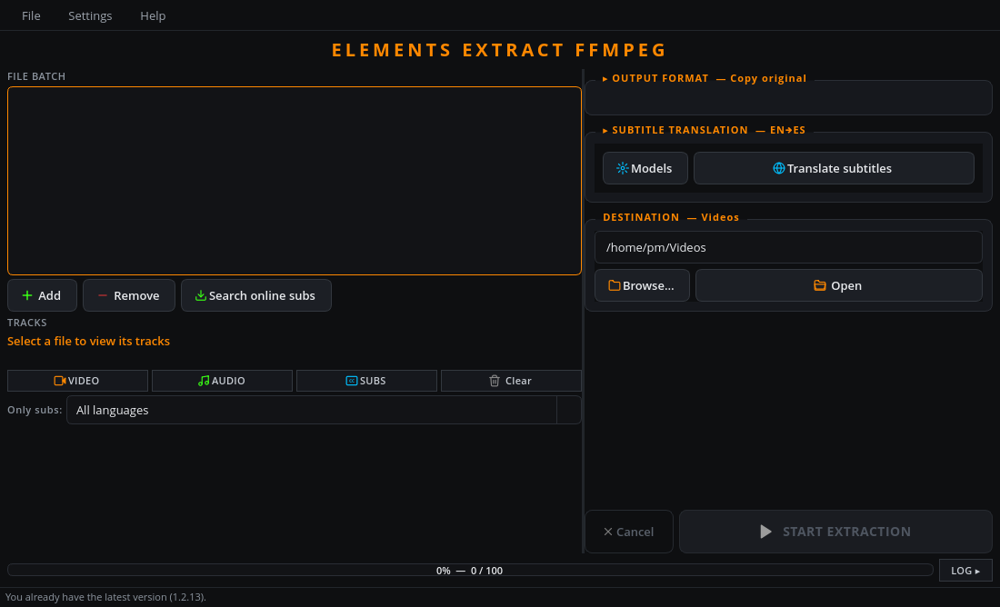
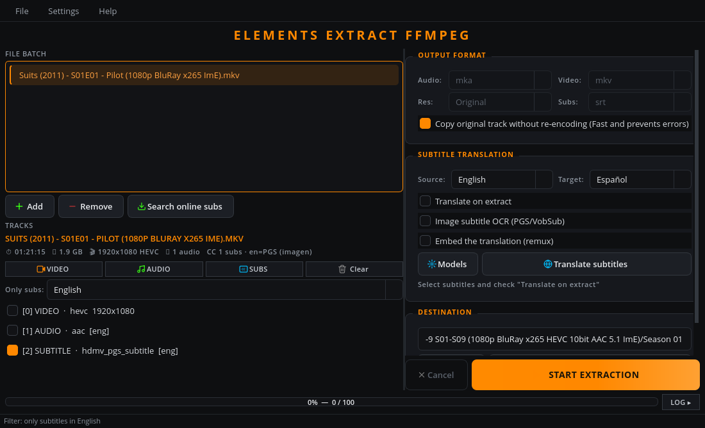
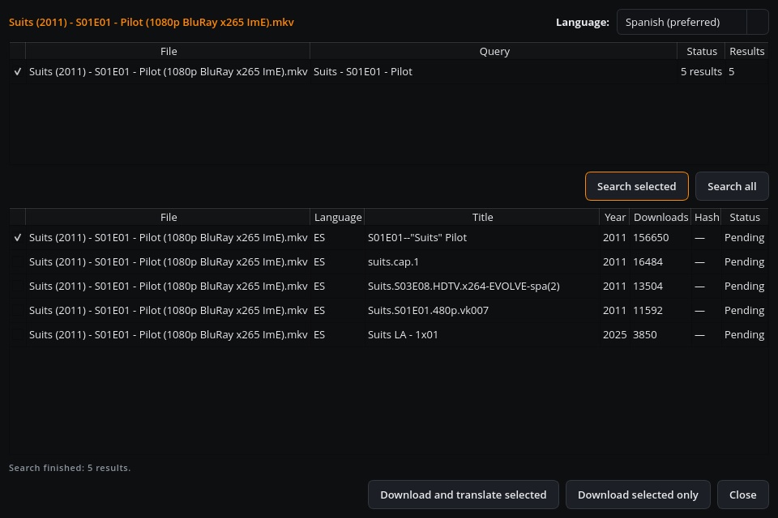
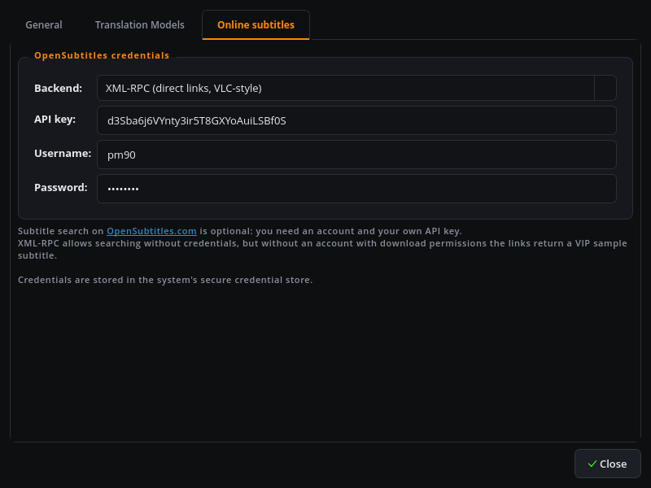
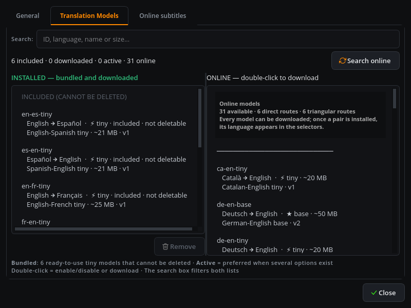
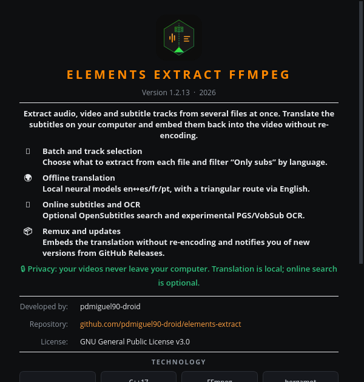

# Elements Extract — FFmpeg

> Descargaste una película o una serie… y le falta algo: **el subtítulo en tu idioma**.
> **Translating subtitles for your movies & series, 100 % offline.**

[](https://github.com/pdmiguel90-droid/elements-extract/actions/workflows/build.yml)
[](https://github.com/pdmiguel90-droid/elements-extract/actions/workflows/windows.yml)
[](https://github.com/pdmiguel90-droid/elements-extract/actions/workflows/appimage.yml)
[](LICENSE)
[](https://www.qt.io/)


**Elements Extract** es un extractor gráfico de pistas (audio, vídeo, subtítulos) con traducción de subtítulos **totalmente offline** (motor local [bergamot-translator](https://github.com/browsermt/bergamot-translator)). La búsqueda de subtítulos online es opcional y solo envía el hash y los metadatos del archivo, nunca el vídeo.

| Ventana principal | Filtro de subtítulos por idioma |
|---|---|
|  |  |
| Búsqueda de subtítulos online | Ajustes: backend XML-RPC |
|  |  |
| Modelos de traducción | Acerca de |
|  |  |

## 🌐 Idiomas / Languages / Idiomas

| Idioma | README |
|--------|--------|
| 🇪🇸 Español | [README.es.md](README.es.md) |
| 🇺🇸 English | [README.en.md](README.en.md) |
| 🇧🇷 Português | [README.pt.md](README.pt.md) |

La interfaz también habla inglés y portugués (detección automática del sistema).

## ✨ Qué hace

- 📼 **Extracción por lotes** de audio, vídeo y subtítulos (MKV, MP4, AVI…).
- 🌍 **Traducción offline** en↔es/fr/pt (+ triangular vía inglés): **6 modelos tiny incluidos**. Otros pares del registro se descargan y sus idiomas aparecen en los selectores.
- 🌐 **Subtítulos online**: búsqueda manual o por lote en opensubtitles.org (XML-RPC estilo VLC, sin clave) o en opensubtitles.com (REST), con descarga, descompresión y traducción posterior.
- 🅾️ **OCR opcional y experimental** de PGS/VobSub a `.srt` traducible con nOCR (desactivado por defecto; puede tardar varios minutos por episodio).
- 🔔 **Aviso de versiones nuevas** desde GitHub Releases, al arrancar o desde Ayuda → Buscar actualizaciones…
- 🎯 **Filtro "Solo subs"** por idioma en todo el lote.
- 📦 **Remux**: un solo `.mkv`/`.mp4` con todas las pistas traducidas, sin re-codificar (repliegue MP4→MKV, limpieza opcional de intermedios).
- 🖥️ Qt6, tema oscuro/claro, español/inglés/portugués.

### 🧠 Modelos incluidos (v1.2.13)

| Modelo | Par | Tamaño |
|---|---|---|
| `en-es-tiny` | English → Español | ~21 MB |
| `es-en-tiny` | Español → English | ~21 MB |
| `en-fr-tiny` | English → Français | ~25 MB |
| `fr-en-tiny` | Français → English | ~26 MB |
| `en-pt-tiny` | English → Português | ~24 MB |
| `pt-en-tiny` | Português → English | ~25 MB |

**Total ~142 MB.** No se incluye ningún modelo `base`. Ajustes → Modelos de Traducción
muestra estos seis como **incluidos y no eliminables**, separa los descargados y ofrece
**todos** los modelos del registro con buscador por ID, idioma, nombre o tamaño.

Detalles por idioma en los README localizados. Mantenimiento de modelos: [docs/modelos.md](docs/modelos.md).

## 📥 Instalar

- **Debian/Ubuntu**: `.deb` de [Releases](https://github.com/pdmiguel90-droid/elements-extract/releases) (`sudo dpkg -i elements-extract-*.deb`).
- **Cualquier distro**: AppImage de [Releases](https://github.com/pdmiguel90-droid/elements-extract/releases) (`chmod +x` y ejecutar).
- **Windows**: zip `*-win64.zip` de [Releases](https://github.com/pdmiguel90-droid/elements-extract/releases) (trae `ffmpeg.exe`, motor `bergamot.exe` y los 6 modelos en la ruta que espera la app).
- **Flatpak / Flathub**: en preparación (ver `flatpak/`).

Necesitas `ffmpeg` en el sistema (solo para `.deb`/compilado; AppImage y Windows lo traen).

## 🔨 Compilar

```bash
cmake -S . -B build-qt6 -DCMAKE_BUILD_TYPE=Release
cmake --build build-qt6 --parallel
./build-qt6/elements-extract
```

Ver [README.es.md](README.es.md#compilar-e-instalar) para dependencias por distro.

## 🤝 Contribuir y seguridad

- [CONTRIBUTING.md](CONTRIBUTING.md) · [SECURITY.md](SECURITY.md) · [CHANGELOG.md](CHANGELOG.md) · [docs/github-metadata.md](docs/github-metadata.md)

## 📄 Licencia

[GPL-3.0-or-later](LICENSE) © pdmiguel90-droid. Traducción local vía bergamot-translator (MPL-2.0) y modelos de [translatelocally.com](https://translatelocally.com).
