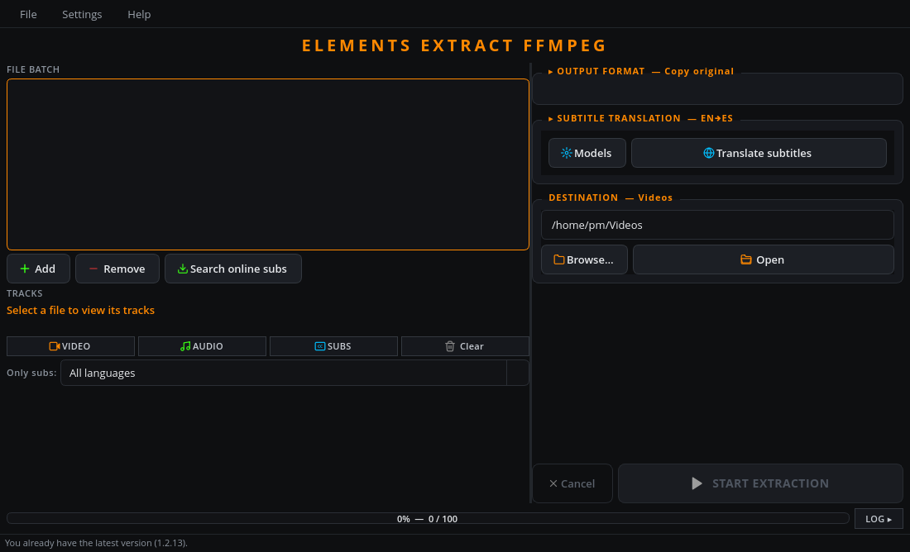
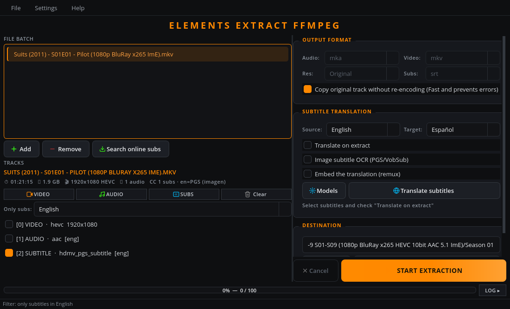
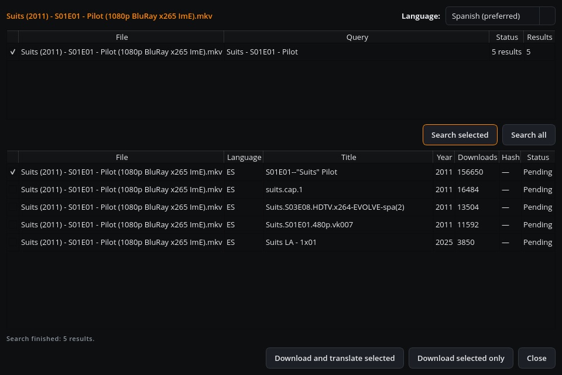
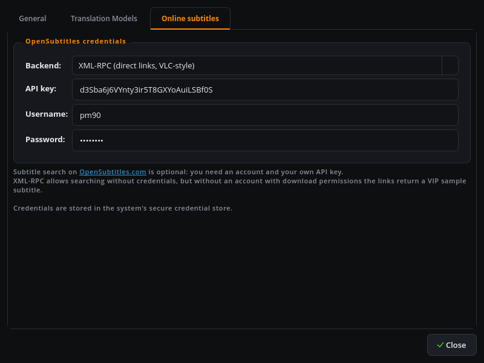

# Elements Extract — FFmpeg

> Você baixou um filme ou uma série… e falta a única coisa que deveria ter: **a legenda no seu idioma**.

**Elements Extract** é um extrator gráfico de faixas de áudio, vídeo e legendas com processamento em lote que também **traduz legendas para o seu idioma 100 % offline**, direto no seu computador.


---

## 🎯 Por que este projeto existe

Este projeto nasceu de uma necessidade pessoal. Quando baixo um filme ou uma série, às vezes acontece isto:

- A legenda que preciso **não está disponível** ou não existe no meu idioma.
- A única que encontro está **dessincronizada** ou é de baixa qualidade.
- Não quero depender de nenhum site para procurá-la nem para "consegui-la".

Então pensei: *e se eu pudesse pegar o arquivo que já tenho no disco e traduzir a legenda eu mesmo, em casa, sem internet?*

**Elements Extract** é exatamente isso: uma ferramenta **offline** que extrai as faixas do seu arquivo e **traduz as legendas para o idioma que você quiser usando o seu próprio computador**, sem precisar depender da internet para encontrá-las.

> 🔒 **Privacidade:** seus arquivos nunca saem da sua máquina. A busca online é opcional e envia apenas o hash e os metadados do arquivo, nunca o vídeo. A tradução é feita localmente com modelos de tradução neural (via [bergamot-translator](https://github.com/browsermt/bergamot-translator)). Você só precisa de internet **uma vez**, para baixar o modelo de idioma; depois pode traduzir o quanto quiser, onde estiver.

---

## Capturas de tela

| Janela principal | Filtro de legendas |
|---|---|
|  |  |
| Busca de legendas online | Ajustes: backend XML-RPC |
|  |  |

---

## Recursos

- 📂 **Processamento em lote** — adicione vários arquivos de uma vez
- 🎯 **Seleção individual de faixas** — marque exatamente quais faixas extrair de cada arquivo
- ▶ **Seleção global por tipo** — botões VIDEO / AUDIO / LEGENDAS selecionam todas as faixas de um tipo em todo o lote
- 📊 **Painel de metadados** — mostra duração, tamanho, resolução e número de faixas ao selecionar um arquivo
- 🔄 **Formatos de saída configuráveis** — escolha MKA, M4A, AAC, MP3, FLAC, OPUS, WAV para áudio; MKV, MP4, AVI para vídeo; SRT, ASS, VTT para legendas
- 📈 **Barra de progresso real** — cálculo de percentual baseado na duração do arquivo
- ✋ **Cancelamento** — cancele o processo a qualquer momento
- 💾 **Persistência** — lembra a pasta de destino, os formatos e o tamanho da janela entre sessões
- 🖱️ **Drag & Drop** — arraste arquivos direto para a janela
- ⌨️ **Atalhos de teclado** — `Ctrl+O`, `Del`, `Ctrl+Enter`, `Esc`, `F1`
- 🌐 **Tradução de legendas offline** — traduza legendas extraídas para o idioma que quiser (en, es, fr, pt)
- 🌐 **Legendas online** — busca manual e em lote no opensubtitles.org (XML-RPC estilo VLC, sem chave API) ou no opensubtitles.com (REST), com download e tradução posterior
- 🅾️ **OCR de imagem (experimental)** — converte PGS/VobSub em `.srt` com nOCR; desativado por padrão e com progresso no registro
- 🔔 **Aviso de novas versões** — consulta o GitHub Releases ao arrancar; também em Ajuda → Procurar atualizações…
- ➡️ **Incrustar a tradução (remux)** — a legenda traduzida é incorporada num novo .mkv/.mp4 com o vídeo e o áudio originais, sem re-codificar (estilo MKVToolNix)
- 🎯 **Filtro de legendas por idioma** — seleciona e traduz apenas as legendas de um idioma específico em todos os arquivos do lote
- 🔄 **Tradução triangular** — quando não há modelo direto (ex.: pt→es), usa intermediários (pt→en→es)
- 🤖 **Detecção automática de idioma** — detecta o idioma das legendas a partir dos metadados do arquivo
- ⬇️ **Modelos baixáveis** — baixe modelos de tradução do translatelocally.com (apenas uma vez)

---

## Formatos suportados

### Contêineres de entrada

| Formato | Faixas de vídeo | Faixas de áudio | Legendas | Notas |
|---------|----------------|-----------------|------------|-------|
| **MKV** (Matroska) | Múltiplas | Múltiplas | SRT, ASS, PGS, DVB | O mais completo — suporta quase tudo |
| **MP4** | 1-2 | Múltiplas | mov_text, cea-608 | Padrão web — compatibilidade universal |
| **AVI** | 1 | 1-2 | Sem legendas | Formato legado |
| **TS/M2TS** | Múltiplas | Múltiplas | DVB, PGS | Blu-ray e broadcast |
| **OGG/OGM** | Múltiplas | Múltiplas | SRT | Open source |
| **FLV** | 1 | 1-2 | Sem legendas | Flash (obsoleto) |
| **WMV** | 1 | 1-2 | SRT | Windows Media |

### Codecs suportados (via ffmpeg)

- **Vídeo**: H.264, H.265/HEVC, VP8, VP9, AV1, MPEG-2, MPEG-4, Theora
- **Áudio**: AAC, MP3, FLAC, Opus, Vorbis, AC3, DTS, PCM, ALAC
- **Legendas**: SRT, ASS/SSA, PGS (Blu-ray), DVB, WebVTT, mov_text

### Formatos de saída

| Tipo | Formatos |
|------|----------|
| **Áudio** | MKA, M4A, AAC, MP3, FLAC, OPUS, WAV |
| **Vídeo** | MKV, MP4, AVI |
| **Legendas** | SRT, ASS, VTT (texto); MKS (imagem, cópia de fluxo) |

> ℹ️ **Legendas de imagem** (PGS de Blu-ray, VobSub/DVD, DVB, XSUB) são extraídas tal como estão em `.mks` por cópia de fluxo, sem recodificação. A caixa **«OCR de legendas de imagem»** (experimental, desativada por padrão) usa **nOCR** para gerar um `.srt` traduzível. Pode levar vários minutos por episódio e o resultado deve ser revisado; a cópia `.mks` é mantida se o OCR falhar.

### Tradução de legendas

| Par | Disponibilidade |
|-----|---------------|
| English → Español | ✅ Modelo direto |
| Español → English | ✅ Modelo direto |
| English → Français | ✅ Modelo direto |
| Français → English | ✅ Modelo direto |
| English → Português | ✅ Modelo direto |
| Português → English | ✅ Modelo direto |
| Português → Español | ↻ Triangular (pt→en→es) |
| Español → Português | ↻ Triangular (es→en→pt) |
| Francés → Español | ↻ Triangular (fr→en→es) |

---

## Dependências

| Dependência | Versão mínima | Uso |
|-------------|----------------|-----|
| Qt6 Widgets | 6.2 | Interface gráfica |
| FFmpeg      | 4.0  | Motor de extração de faixas |
| ffprobe     | 4.0  | Análise de streams e metadados |
| CMake       | 3.5  | Sistema de compilação |
| Compilador C++ | C++17 | GCC ≥ 7 / Clang ≥ 5 |
| zlib1g-dev   | —     | Descompactação da base nOCR do OCR opcional |

> **Nota sobre versões do ffmpeg**: Versão 4.x+ recomendada para melhor suporte a legendas PGS (Blu-ray) e codecs modernos (AV1, Opus). Qualquer ffmpeg dos últimos 3 anos funciona corretamente.

### Instalar dependências no Debian/Ubuntu

```bash
sudo apt install qt6-base-dev libgl1-mesa-dev cmake build-essential ffmpeg zlib1g-dev
```

### Instalar dependências no Fedora

```bash
sudo dnf install qt6-qtbase-devel cmake gcc-c++ ffmpeg
```

### Instalar dependências no Arch Linux

```bash
sudo pacman -S qt6-base cmake base-devel ffmpeg
```

---

## Compilar e instalar

```bash
# Clonar o repositório
git clone https://github.com/pdmiguel90-droid/elements-extract.git
cd elements-extract

# Criar o diretório de build
mkdir build && cd build

# Configurar e compilar
cmake .. -DCMAKE_BUILD_TYPE=Release
make -j$(nproc)

# Executar diretamente
./elements-extract
```

### Instalação no sistema (opcional)

```bash
# Copiar o binário
sudo cp build/elements-extract /usr/local/bin/elements-extract

# Registrar no menu de aplicativos
cp elements-extract.desktop ~/.local/share/applications/
```

### Pacote Debian (.deb)

```bash
cd build
cpack -G DEB
sudo dpkg -i elements-extract-*.deb
```

---

## Uso

### Extrair faixas

1. **Adicionar arquivos**: clique em *Adicionar* ou arraste arquivos para a lista (`Ctrl+O`)
2. **Selecionar faixas**: clique em um arquivo → marque as faixas a extrair
3. **Seleção global**: use os botões *VIDEO / AUDIO / LEGENDAS* para selecionar um tipo em todos os arquivos do lote
4. **Formato de saída**: escolha o contêiner desejado na seção *Formato de Saída*
5. **Destino**: selecione a pasta de saída
6. **Extrair**: pressione *INICIAR EXTRAÇÃO* ou `Ctrl+Enter`

### Traduzir legendas

1. Selecione o **idioma de destino** (es, en, fr, pt)
2. Marque a caixa **"Traduzir ao extrair"**
3. Extraia normalmente — as legendas traduzidas são salvas como `arquivo.es.srt`
4. Se não houver modelo direto (ex.: pt→es), a **tradução triangular** é usada automaticamente

> 🌐 **Legendas online (manual e em lote)**: é possível buscar, baixar e traduzir legendas do [OpenSubtitles.com](https://www.opensubtitles.com) com o botão **«Buscar subs online»**, em **Arquivo → Buscar legendas na internet…** (`Ctrl+Shift+S`) ou com o **clique direito** sobre um arquivo da lista. A lista aceita seleção múltipla, permitindo processar vários vídeos de uma vez.
>
> Na janela, marque os arquivos a pesquisar (**Buscar nos selecionados**) ou use **Buscar em todos**. Dê **duplo clique na coluna «Consulta»** para alterar manualmente o título pesquisado de um arquivo específico; o idioma escolhido aplica-se a toda a busca. Depois marque os resultados e pressione **Baixar e traduzir selecionados** ou **Apenas baixar selecionados**: os downloads são sequenciais e o resultado de cada arquivo é informado.
>
> O backend padrão é o **XML-RPC do opensubtitles.org**, como o VLSub no VLC: busca anônima, sem conta nem chave API. Em **Ajustes → Legendas online** é possível mudar para a **API REST do opensubtitles.com**; nesse modo são necessários chave API, usuário e senha próprios, salvos no **armazenamento seguro do sistema** (Secret Service no Linux, Credential Manager no Windows e Keychain no macOS). O idioma de destino dos Ajustes aparece primeiro e destacado nos resultados; se não houver legenda nesse idioma, o app oferece traduzir outra.

> 💡 **Trabalhar com um único idioma**: a lista **"Apenas legendas"** seleciona de uma vez as legendas de um idioma específico em todos os arquivos do lote (arquivos sem esse idioma são ignorados). Com o filtro ativo, a tradução usa esse idioma como origem automaticamente.

> 🎬 **Incrustar a tradução**: com a caixa **"Incrustar a tradução (remux)"** marcada, é gerado um novo `.mkv`/`.mp4` (`arquivo.<idioma>.mkv`) com o vídeo e o áudio originais e a faixa de legendas traduzidas incorporada (sem re-codificar). É salvo em `Elements Extract/Remuxados`. Antes de incorporar, cada arquivo é validado: sem faixa de vídeo é ignorado e, se o `.mp4` tiver codecs não copiáveis (áudio `pcm_*`, `vorbis`, `flac`, `dts`, `truehd`…), muda para `.mkv` automaticamente. No final mostra um resumo com incorporadas/ignoradas e o motivo de cada falha.

### Gerenciamento de modelos

1. Vá em **Ajustes → Configuração e Modelos** (`Ctrl+,`)
2. Na aba **Modelos de Tradução**:
   - **Instalados**: modelos baixados — clique duas vezes para ativar/desativar
   - **Online**: modelos disponíveis — clique duas vezes para baixar
3. O diálogo mostra quais pares têm modelo direto (✓) e quais exigem tradução triangular (↻)

### Atalhos de teclado

| Atalho | Ação |
|-------|--------|
| `Ctrl+O` | Adicionar arquivos |
| `Del` | Remover arquivos selecionados |
| `Ctrl+Enter` | Iniciar extração |
| `Esc` | Cancelar extração |
| `F1` | Manual de uso |
| `Ctrl+Q` | Sair |

---

## Contribuir

1. Faça um fork do repositório
2. Crie uma branch: `git checkout -b feature/minha-melhoria`
3. Faça suas alterações e faça commit: `git commit -m 'feat: descrição'`
4. Envie a branch: `git push origin feature/minha-melhoria`
5. Abra um Pull Request

---

## Licença

Este projeto está licenciado sob a **GNU General Public License v3.0**.
Consulte o arquivo [LICENSE](LICENSE) para mais detalhes.

---

## Créditos

Desenvolvido por **pdmiguel90-droid**  
Construído com [Qt6](https://www.qt.io/), [FFmpeg](https://ffmpeg.org/) e C++17.